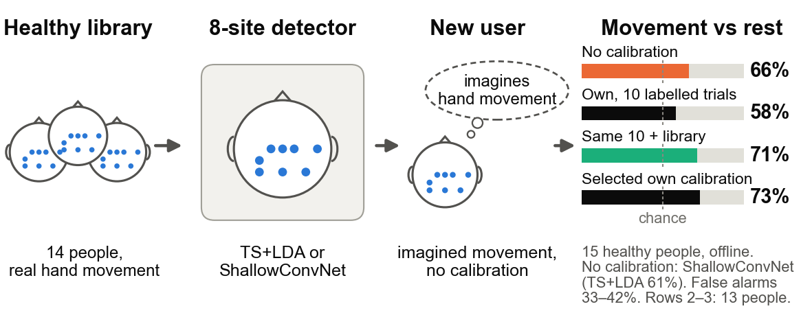

# How much calibration does a library of other people's executed movements replace?

Code, per-person results and analysis protocols for:

> Fady Mostafa, Amr Mostafa. *How much calibration does a library of other people's executed movements replace? A controlled
> EEG study of imagined upper-limb movement versus rest.* Manuscript submitted to *Biomedical Signal Processing and Control*
> (under review), 2026.



## The study in short
A new user of a motor-imagery brain–computer interface usually starts with a tiring calibration session. We asked how much
of it a detector trained on **other people's executed movements** (the *library*) can replace, on the public upper-limb
dataset of Ofner et al. (2017): 15 healthy adults, 61 EEG and 3 EOG channels, one executed and one imagined session each.

- **Task:** imagined hand movement (opening or closing) versus rest, cue-paced. Rest is a cued class inside the same runs,
  so both classes share the timing and a cue picture.
- **Design:** leave-one-subject-out. The library is the executed movements of the other 14 people; the test set is always
  the new person's imagery runs 6–10. Other people's imagery was used only for model selection (sites, early stopping,
  thresholds, window); the new person's test runs never inform any choice.
- **Decoders:** a Riemannian tangent-space classifier with shrinkage LDA (TS+LDA, primary) and ShallowConvNet, on eight
  sites selected without the test person.

Main results (balanced accuracy, mean of 15 people):

| | TS+LDA | ShallowConvNet |
|---|---|---|
| Zero calibration (no data from the new person) | 61.0% | 66.3% |
| Labelled trials the strongest own-calibration pipeline needs to reach that level | 10–20 | 20–30 |

- Own calibration selected per person on the calibration runs (from eight pre-specified decoders): 73.1%.
- With the same first 10 labelled trials and windows from 1.0 s, the library-based hybrid reached 71.2% and own
  calibration alone 58.2% (n = 13; descriptive). From 45 trials we found no difference between them.
- The detector also fired on imagined elbow and forearm movements (61.3% of trials, against 64.2% for the hand and 42.2%
  for rest): it detects imagined upper-limb movement versus rest, not the hand specifically.
- Eye-only and frontal-only inputs stayed near chance (50.7–52.1%), as did pre-cue windows and shuffled labels.
- Limitations: false alarms of 30–45% of rest trials at the default rule, decisions at 3 s after the cue, one dataset,
  healthy people, offline cue-paced analysis.

The paper gives the full results, the statistics and the limitations; this repository lets every number be traced to a
per-person result file and the code that produced it.

## Repository layout
```
code/
  01_preprocessing/preprocess_ofner.py        raw GDF -> runs at 128 Hz + events + meta (Section 2.1)
  02_sanity_check/sanity_check_ofner2017.py   Ofner et al. (2017) within-person decoding on our files
  03_analysis/<step folder>/*.py              the analysis scripts as run (Google Colab), one folder per step
  figures_tables/make_figures_tables.py       Figures 1-10, graphical abstract, Tables 1-6 and S1-S8, p-value audit
  figures_tables/p2style.py                   figure style (Elsevier artwork rules)
results/
  registry/                                   frozen trial and bad-channel registry, channel order
  <step folder>/                              per-person result files (CSV/JSON) and run logs, same names as code/03_analysis
docs/
  protocols/                                  the two dated analysis protocols (verbatim)
  ANALYSIS_TIMELINE.md                        order and dates of all analyses
  figures/                                    previews of the figures (regenerated by the figure script)
verification/                                 logs of the checks described below
requirements.txt
```
No EEG data are included. Model weights and intermediate caches are not included.

## Data
- **Ofner et al. (2017):** BNCI Horizon 2020 data set 001-2017, [Zenodo record 834976](https://zenodo.org/records/834976)
  (300 GDF files; `motorexecution_subject{1-15}_run{1-10}.gdf`, `motorimagination_subject{1-15}_run{1-10}.gdf`).
  Checksums of the files we used are in `results/00_data_audit/`. MOABB's `Ofner2017` dataset downloads the same files.
- **PhysioNet EEG Motor Movement/Imagery Database** v1.0.0: <https://physionet.org/content/eegmmidb/1.0.0/>.

## How the code is organised and how to run it
1. **Preprocessing** (CPU, a few minutes per session):
   ```
   python code/01_preprocessing/preprocess_ofner.py --raw <folder with the 300 GDF files> --out data/preprocessed
   ```
2. **Sanity check** against Ofner et al. (2017) (CPU, about 3 min per person):
   ```
   python code/02_sanity_check/sanity_check_ofner2017.py --data data/preprocessed --out outputs/sanity_check
   ```
3. **Analyses.** The scripts in `code/03_analysis/` are kept exactly as they were run on Google Colab, so that the record
   is not changed after the fact. Each one sets `ROOT` at the top to the Google Drive folder of the project and expects
   the preprocessed files in `<ROOT>/01_preprocessed/`; to re-run one, set `ROOT` and keep the folder names. They were
   run in the order below; later steps read the result files and caches of earlier ones.
4. **Figures and tables** from the saved result files only (CPU, a few minutes):
   ```
   python code/figures_tables/make_figures_tables.py
   ```
   It reads `results/` and writes to `outputs/figures` and `outputs/tables` (folders can be changed with the environment
   variables `P2_RESULTS`, `P2_FIG_OUT`, `P2_TAB_OUT`; `P2_ONLY="Figure 5,Tables 1-6, S8"` runs a subset). It compares
   92 numbers with the values documented during the analyses and prints the result.

| Step folder | Script(s) | What it does | In the paper |
|---|---|---|---|
| `00_data_audit` | – | Checksums of the raw files, event and channel audit, glove checks, the subject-4 channel check | 2.1 |
| `02_A2_sanity` | (`code/02_sanity_check`) | Within-person decoding as in Ofner et al. (2017) | 2.1 (replication check) |
| `03_A2b_electrodes` | `a2b1.py`, `a2b2.py` | Nested electrode selection, site frequencies, selection bias | 2.3, 3.1, Fig. 3 |
| `04_A3_ceiling` | `a3.py` | Own-calibration ceiling; Lee et al. (2022) trial split | not reported (earlier check) |
| `05_A4_four_cells` | `a4a.py` | Four training sources with TS+LDA; controls | 3.2, 3.7, Figs. 4, 9 |
| `06_A6_adaptation` | `a6.py` | First unsupervised-adaptation analysis | superseded by 10 and 11 |
| `07_A4b_deep` | `a4b1.py`, `a4b1c.py` | ShallowConvNet in the four cells; controls (GPU) | 3.2, 3.7, Figs. 4, 9 |
| `08_A7_physionet` | `a7_1.py` | PhysioNet left vs right fist; frontal/temporal removal vs random removal (GPU) | 2.10, 3.8, Fig. 10a |
| `09_A7_2a_physionet_rest` | `a72a.py` | PhysioNet right fist vs rest; occipital control (GPU) | 3.8, Fig. 10b |
| `10_A8_calibration` | `a8.py` | Calibration curves, all windows: own, recentering, hybrid | 3.3, Table S4 |
| `11_A9_robustness` | `a9.py` | Equivalence tests, decision time, hit/false-alarm rates, 10-20 site sets | 3.1, 3.5, 3.6, Table 2, Fig. 8 |
| `12_A10_deep_calibration` | `a10.py`, `a10b.py`, `a10c.py` | Deep-model calibration curve (GPU). `a10.py` is the discarded first run (it did not reproduce the deep four-cell result); `a10b.py` is the final run; `a10c.py` repeats it for hit and false-alarm rates | 3.3, 3.5, Tables 5, S2, S3 |
| `14_A11_13` | `a11_13_gpu.py`, `a11_13_cpu.py` | Protocol 1: library size, operating points and AUC, window choice, ensemble | 3.4–3.6, Figs. 6, 7, Tables S5–S8 |
| `15_R1_followup` | `n1_n3.py`, `n4_n5.py`, `n5_same_budget.py` | Protocol 2: own-calibration references, specificity, multiplicity (N1–N3); deep-model EOG/frontal controls (GPU) and calibration curves from 1.0 s (N4–N5); same-budget hybrid vs own comparison | 2.6, 3.3, 3.5, 3.7, Fig. 5, Tables 4, S1, S4 |

Notes on the record
- `n5_same_budget.py` is a rewrite of the short correction script of 13 Nov 2026, which was not kept; it reproduces the
  saved `N5_same_budget.csv` (see Verification).
- The preprocessing and sanity-check scripts in `code/01_preprocessing` and `code/02_sanity_check` were rebuilt for this
  repository, because the original notebook cells were not saved as files; both were checked against the saved outputs.
- An earlier table script (`make_tables.py`) is superseded by `make_figures_tables.py` and not included.
- The trial and channel registry (`results/registry/`) was built before this study with an EEGLAB-style rule (Section 2.1
  of the paper) and is used as it was frozen. Imagery results in `02_A2_sanity/A2_per_subject.csv` come from the first run
  with class-specific timing (a label leak, see `docs/ANALYSIS_TIMELINE.md`); the valid imagery values are the
  `subject_mean` rows of `A2_MI_alignment_check.csv`.

## Verification of this repository (15 Nov 2026)
| Check | Result |
|---|---|
| Preprocessing rebuilt from the 300 raw GDF files | 30/30 sessions identical to the files used for the paper (largest signal difference 0; events, cue times and samples identical) |
| Sanity check rebuilt | Leave-one-run-out accuracy identical in 60/60 values; six-movement 10×10 cross-validation identical. Movement-vs-rest 10×10 values differ slightly per person because the random subsample of movement trials of the first run was not recorded (group means 83.1 and 83.4% for executed, 71.7 and 72.1% for imagined movements in the two runs) |
| Repository versions of the scripts (16 Nov 2026, `verification/VERIFY_LOG.txt`) | Preprocessing, subject 1: both sessions identical. Sanity check, subject 1: leave-one-run-out 12/12 and six-movement 10×10 6/6 identical. `n5_same_budget.py`: 12/12 rows identical to the saved file. Figure and table script run from `results/`: all figures and tables built, 92/92 checks against the documented values passed, no conclusion changed in the p-value audit (45 comparisons) |

Sanity check against the published values (group means, 15 people; Ofner et al. 2017, 0.6-s window; their abstract
quotes 87% for executed movement vs rest with other window lengths):

| Task | Ofner et al. | Ours, 10×10 CV | Ours, leave-one-run-out |
|---|---|---|---|
| Executed, six movements | 55% | 54.5% | 53.1% |
| Executed, movement vs rest | 86% | 83.1–83.4% | 85.5% |
| Imagined, six movements | 27% | 26.1% | 26.1% |
| Imagined, movement vs rest | 73% | 71.7–72.1% | 72.9% |

## Software
Python 3.13 on Google Colab with NumPy 2.4, SciPy 1.16, scikit-learn 1.6, PyTorch 2.14 and MNE-Python (the final analysis
run). `requirements.txt` lists the packages imported by the code, with the versions of the Colab runtime used for the
verification run.

## Use of AI tools
As stated in the paper, the authors used a large language model (Claude, Anthropic) to help plan the analyses, to write
the analysis and figure code and to check statistical computations; the repository versions of the preprocessing and
sanity-check scripts and this README were prepared the same way. The authors ran all code on the data and reviewed every
analysis decision and result.

## License and citation
Code: MIT License (see `LICENSE`). Result files and documents: CC BY 4.0. Please cite the paper above (the citation will
be updated on publication) and the dataset: Ofner P, Schwarz A, Pereira J, Müller-Putz GR. Upper limb movements can be
decoded from the time-domain of low-frequency EEG. *PLoS ONE* 2017;12(8):e0182578.
<https://doi.org/10.1371/journal.pone.0182578>

Contact: Fady Mostafa, Queen's University (corresponding author of the paper).
